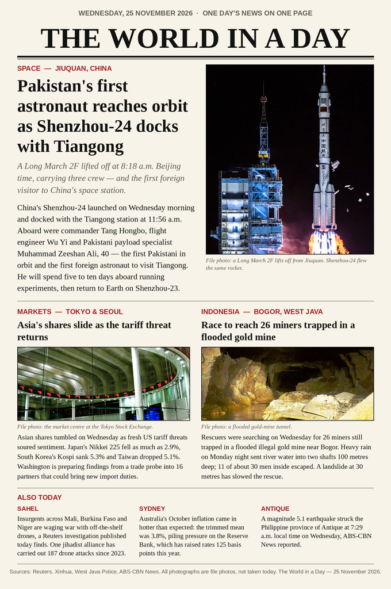

# news-image-20261125

[](https://make.fun/competitions/news-image-20261125)
[](https://make.fun/competitions/news-image-20261125)
[](https://make.fun/competitions/news-image-20261125)

A broadsheet summing up the world's news of **Wednesday 25 November 2026**
in one image — an entry for make.fun's
[Sum up 25 November's world news in one image](https://make.fun/competitions/news-image-20261125)
bounty ($100, top 50 share). This edition keeps the winning broadsheet
structure of the series (Ruu has placed six straight) with a new nameplate,
a portrait lead photo and a two-story second row.



## The day, in brief

- **Jiuquan, China** — Shenzhou-24 launched at 8:18 a.m. Beijing time and
  docked with the Tiangong station at 11:56 a.m. Aboard were commander Tang
  Hongbo, flight engineer Wu Yi and Pakistani payload specialist Muhammad
  Zeeshan Ali, 40 — the first Pakistani in orbit and the first foreign
  astronaut to visit Tiangong. He will spend five to ten days aboard
  running experiments, then return on Shenzhou-23. (Reuters, Xinhua)
- **Tokyo & Seoul** — Asian shares tumbled on Wednesday as fresh US tariff
  threats soured sentiment: the Nikkei 225 fell as much as 2.9%, the Kospi
  sank 5.3% and Taiwan dropped 5.1%. Washington is preparing findings from
  a trade probe into 16 partners that could bring new import duties.
  (Reuters)
- **Bogor, West Java** — Rescuers were searching on Wednesday for 26 miners
  still trapped in a flooded illegal gold mine near Bogor. Heavy rain on
  Monday night sent river water into two shafts 100 metres deep; 11 of
  about 30 men inside escaped, and a landslide at 30 metres has slowed the
  rescue. (Reuters, West Java Police)
- **Also today** — Insurgents across Mali, Burkina Faso and Niger are
  waging war with off-the-shelf drones, a Reuters investigation published
  today finds; Australia's October inflation came in hotter than expected
  (trimmed mean 3.8%); a magnitude 5.1 earthquake struck Antique province
  in the Philippines at 7:29 a.m. local time.

Every story's event was date-checked against primary sources: the event
itself happened, or was first reported, on 25 November 2026, not merely
reported then. Stories whose events fell on an earlier date were left out:
the Houthi strike on a Riyadh tower (24 Nov), the Chen Jining probe
(24 Nov), the Eisenkot–Lieberman coalition pact (24 Nov), the Huawei jury
verdict (24 Nov), the Cikande factory-fire toll update (24 Nov) and the
Champions League results (24 Nov).

## How it works

`tools/render.py` draws the broadsheet (680×1024 PNG) from real, freely
licensed file photos and the verified news text. `main.py` copies the
finished image to `/output/entry.png` — no network, no randomness, the same
bytes on every run.

```sh
python3 tools/render.py   # rebuild entry.png
python3 main.py           # write /output/entry.png
```

## Photo credits (file photos, not from the day)

- Long March 2F lifting off from Jiuquan (Shenzhou 13) — Wikimedia Commons /
  ForrestXYC, CC BY-SA 4.0
- Market centre at the Tokyo Stock Exchange — Wikimedia Commons /
  Jacob Ehnmark, CC BY 2.0
- Flooded gold-mine tunnel (Gold King Mine) — Wikimedia Commons, public domain

## Licence

MIT — see [LICENSE](LICENSE).
